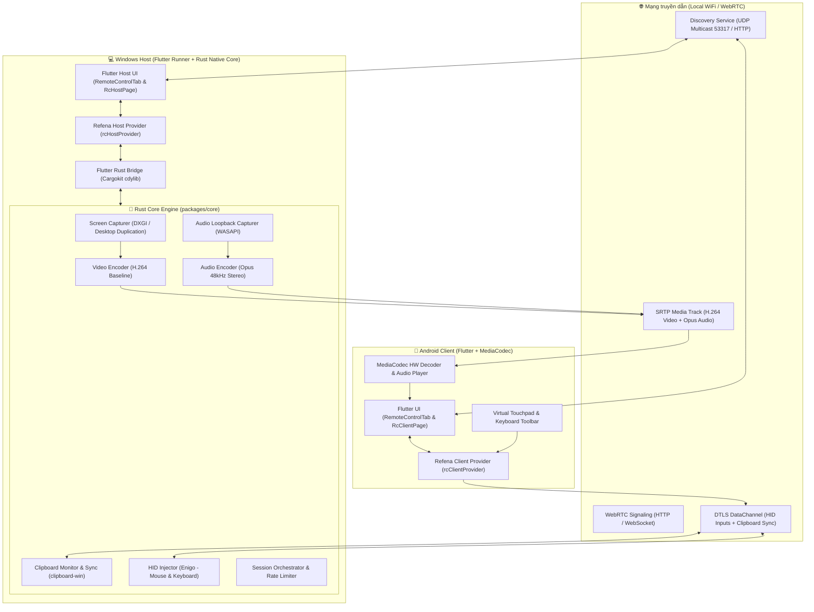

# TÀI LIỆU ĐẶC TẢ TOÀN DIỆN & BLUEPRINT THIẾT KẾ DỰ ÁN
## REMOTE DESKTOP LOCAL (v2.0)
> **Master Technical Specification, Architecture, UI/UX Design & Deployment Blueprint**  
> *Phiên bản:* 2.0.0 | *Hệ điều hành hỗ trợ:* Windows 10/11 (Host), Android 8.0+ (Client)  
> *Ngôn ngữ & Công nghệ chính:* Flutter 3.41+ (Dart), Rust 2021/2024, WebRTC (DTLS-SRTP), Cargokit, Refena State Management.

---

## 1. TỔNG QUAN DỰ ÁN (EXECUTIVE SUMMARY)

### 1.1 Tầm nhìn sản phẩm (Product Mission)
Xây dựng một giải pháp **điều khiển máy tính từ xa trong mạng nội bộ (LAN / WiFi)** và **qua Internet relay (P2P / TURN)** đạt chuẩn bảo mật cao, tốc độ mượt mà (30/50/60 FPS), không phụ thuộc vào các dịch vụ đám mây của bên thứ ba (như TeamViewer, AnyDesk), bảo vệ hoàn toàn quyền riêng tư của dữ liệu người dùng.

### 1.2 Mô hình vai trò (Roles & Platforms)
```
┌────────────────────────────────────────────────────────────────────────┐
│                          HỆ THỐNG 2 THÀNH PHẦN                         │
├────────────────────────────────────────────────────────────────────────┤
│ 💻 HOST (Máy tính bị điều khiển)     │ 📱 CLIENT (Thiết bị điều khiển) │
│ - Nền tảng: Windows 10 / 11 (x64)    │ - Nền tảng: Android (ARM64/v7)  │
│ - Chụp màn hình DXGI (VRAM GPU)      │ - Nhận luồng video & giải mã    │
│ - Thu âm thanh hệ thống (WASAPI)     │ - Thu phát âm thanh máy tính    │
│ - Nhận lệnh phím / chuột (Enigo)     │ - Chuyển cảm ứng thành chuột    │
│ - Đồng bộ Clipboard hai chiều        │ - Gõ phím ảo + thanh phím tắt   │
└────────────────────────────────────────────────────────────────────────┘
```

---

## 2. KIẾN TRÚC HỆ THỐNG (SYSTEM ARCHITECTURE)

### 2.1 Sơ đồ kiến trúc tổng thể (High-level Block Diagram)



### 2.2 Công nghệ & Thư viện sử dụng (Tech Stack)

| Thành phần | Công nghệ / Thư viện | Vai trò kỹ thuật |
|---|---|---|
| **Frontend UI** | Flutter SDK (Channel Stable 3.41+) | Xây dựng giao diện đa nền tảng nhất quán |
| **State Management** | `refena_flutter` + `refena` (v3.5+) | Quản trị state phản ứng (reactive), cấu trúc hướng hành động (GlobalAction) |
| **Native Integration** | `flutter_rust_bridge` (v2.12.0) | Cầu nối FFI an toàn giữa Dart và Rust |
| **Native Build Harness** | `cargokit` | Tích hợp CMake/Gradle biên dịch Rust cùng Flutter |
| **Core Engine** | Rust (Edition 2021 / 2024) | Chịu trách nhiệm capture, encode, inject HID và bảo mật |
| **HID Simulation** | `enigo = "0.2"` | Giả lập sự kiện chuột tuyệt đối/tương đối và phím bấm trên Windows |
| **Clipboard Native** | `clipboard-win = "5.0"` | Đọc và ghi Clipboard Windows ở tầng native OS |
| **Network & Transport** | `tokio`, `tokio-util`, WebRTC | Xử lý bất đồng bộ, DataChannel DTLS và SRTP stream |
| **Serialization** | `serde`, `serde_json` | Đóng gói bản tin JSON giao thức điều khiển |

---

## 3. ĐẶC TẢ GIAO THỨC & DỮ LIỆU (WIRE PROTOCOL SPECIFICATION)

### 3.1 Dạng tin nhắn từ Client gửi đến Host (`RcClientMessage`)

Tất cả các gói tin gửi qua WebRTC DataChannel (nhãn `rc-control`) được định dạng JSON:

#### 1. Chuột tương đối (Trackpad di chuột)
```json
{
  "type": "MouseMove",
  "dx": 12.5,
  "dy": -8.0
}
```
*Ràng buộc bảo mật:* `dx`, `dy` bắt buộc clamp trong đoạn `[-2000.0, 2000.0]`. Bỏ qua nếu giá trị là `NaN` hoặc `Infinity`.

#### 2. Chuột tuyệt đối (Chạm trực tiếp vào vị trí màn hình)
```json
{
  "type": "MouseAbsolute",
  "x": 0.4523,
  "y": 0.8120
}
```
*Ràng buộc bảo mật:* `x`, `y` chuẩn hoá trong đoạn `[0.0, 1.0]`. Nhân với chiều rộng (`screen_w`) và chiều cao (`screen_h`) của Host để ra toạ độ pixel thực tế.

#### 3. Nút bấm chuột (Mouse Button)
```json
{
  "type": "MouseButton",
  "button": "Left",
  "pressed": true
}
```
*Các giá trị `button`:* `"Left"`, `"Right"`, `"Middle"`.

#### 4. Cuộn chuột (Mouse Scroll)
```json
{
  "type": "MouseScroll",
  "dx": 0.0,
  "dy": 120.0
}
```
*Ràng buộc bảo mật:* `dy`, `dx` clamp trong đoạn `[-500.0, 500.0]`.

#### 5. Phím bấm (Key Event)
```json
{
  "type": "KeyEvent",
  "key": "ctrl",
  "pressed": true,
  "modifiers": ["shift"]
}
```
*Hỗ trợ các phím đặc biệt:* `ctrl`, `alt`, `shift`, `meta`/`win`, `enter`, `backspace`, `delete`, `escape`, `tab`, `space`, `up`, `down`, `left`, `right`, `home`, `end`, `pageup`, `pagedown`, `f1` - `f12`.

#### 6. Gửi Clipboard từ Client lên Host
```json
{
  "type": "ClipboardUpdate",
  "content": "Chuỗi văn bản cần paste vào máy tính...",
  "format": "Text"
}
```
*Ràng buộc bảo mật:* Kích thước `content` tối đa là **10 MB** (Anti-DoS).

---

### 3.2 Dạng tin nhắn từ Host gửi về Client (`RcHostMessage`)

#### 1. Thông báo độ phân giải màn hình
```json
{
  "type": "ScreenResolution",
  "width": 1920,
  "height": 1080
}
```

#### 2. Đồng bộ Clipboard từ Host về Client
```json
{
  "type": "ClipboardUpdate",
  "content": "Nội dung vừa copy trên máy tính",
  "format": "Text"
}
```

#### 3. Cập nhật trạng thái phiên
```json
{
  "type": "SessionStatus",
  "fps": 60,
  "bitrateKbps": 4000,
  "clientAlias": "Samsung Galaxy S24"
}
```

---

## 4. THIẾT KẾ GIAO DIỆN & TRẢI NGHIỆM (UI/UX SPECIFICATIONS)

### 4.1 Quy chuẩn Thiết kế (Design Tokens)
- **Hệ màu chủ đạo:** Teal Theme (Material 3). Primary: `Color(0xFF006A60)`, Secondary Container: `Color(0xFFCCE8E3)`.
- **Bo góc (Border Radius):** Nút bấm và thẻ card tiêu chuẩn dùng `BorderRadius.circular(10)` hoặc `BorderRadius.circular(12)`.
- **Typography:** Font hệ thống, title bold 20-22sp, body 14sp, subtitle 12sp màu xám (`Colors.grey`).

### 4.2 Tab "Remote Desktop" trên Host (Máy tính)
```
┌───────────────────────────────────────────────────────────┐
│ [🖥️] Remote Desktop                                       │
│                                                           │
│  ┌─────────────────────────────────────────────────────┐  │
│  │                   [LocalSend Logo]                  │  │
│  │                Remote Desktop Control               │  │
│  │        [Máy chủ: Đang bật]   [Đang bị điều khiển]   │  │
│  │                                                     │  │
│  │        [ ⏹️ Tắt nhận ]         [ ⚙️ Cài đặt ]         │  │
│  └─────────────────────────────────────────────────────┘  │
│                                                           │
│ 💻 Máy tính trong mạng (Để điều khiển)        [🔄] [➕]   │
│ ┌───────────────────────────────────────────────────────┐ │
│ │ 📱 Laptop-Office (192.168.100.105)        [Kết nối]   │ │
│ └───────────────────────────────────────────────────────┘ │
│                                                           │
│ 🔴 Đang bị điều khiển bởi: Phone-Quan (00:04:12)   [Ngắt] │
└───────────────────────────────────────────────────────────┘
```

1. **Thẻ điều khiển Host (Host Card):**
   - Logo quay khi có phiên kết nối đang mở.
   - Nút lớn (BigButton): **"Bật nhận"** (khi tắt) / **"Tắt nhận"** (khi bật).
   - Nút **"Cài đặt"**: Mở màn hình cấu hình mã PIN bắt buộc (4-8 số), tuỳ chọn FPS (30/50/60 FPS).
2. **Banner cảnh báo đỏ (Visual Indicator & Kill Switch):**
   - Khi có phiên điều khiển: Ghim cố định ở chân trang với màu đỏ nhạt, hiển thị tên máy đang điều khiển và nút **"Ngắt"** lập tức kết thúc phiên kết nối.

### 4.3 Tab "Remote Desktop" trên Client (Điện thoại)
1. **Tự động quét thiết bị (Smart Scan):**
   - Khi mở tab, hệ thống tự động phát hiện các máy tính đang mở ứng dụng trong cùng WiFi.
2. **Nút kết nối thủ công (Direct Connect Dialog):**
   - Biểu tượng dấu `+` trên thanh tiêu đề mở hộp thoại:
     - Trường nhập: **Địa chỉ IP máy tính** (ví dụ `192.168.100.107`).
     - Trường nhập: **Mã PIN** (nếu Host yêu cầu).
     - Nút **"Kết nối"** và nút **"Hủy"**.

### 4.4 Màn hình điều khiển toàn màn hình (`RcClientPage`)
```
┌─────────────────────────────────────────────────────────┐
│ [<-] PC-Workspace (192.168.100.107)        [🔊] [⛶] [✕] │
├─────────────────────────────────────────────────────────┤
│                                                         │
│                                                         │
│                [KHUNG HÌNH STREAM 16:9]                 │
│              Màn hình Windows truyền về                 │
│                                                         │
│                                                         │
├─────────────────────────────────────────────────────────┤
│ [Ctrl] [Alt] [Shift] [Win] [Tab] [Esc] [Enter] [F1..F12]│
├─────────────────────────────────────────────────────────┤
│                                                         │
│                  VÙNG VIRTUAL TRACKPAD                  │
│       - 1 ngón di = di chuột    - 1 ngón tap = click trái│
│       - 2 ngón tap = click phải - 2 ngón vuốt = cuộn     │
│                                                         │
└─────────────────────────────────────────────────────────┘
```

---

## 5. MÔ HÌNH BẢO MẬT 5 LỚP (5-LAYER SECURITY MODEL)

```
┌────────────────────────────────────────────────────────┐
│                   MÔ HÌNH BẢO MẬT 5 LỚP                │
├────────────────────────────────────────────────────────┤
│ Lớp 1: Mã hóa E2E        │ DTLS 1.2/1.3 + SRTP (WebRTC)│
│ Lớp 2: Xác thực danh tính│ SHA-256 Fingerprint + Cert  │
│ Lớp 3: Cửa kiểm soát PIN │ Hash + Salt + Rate Limiting │
│ Lớp 4: Phê duyệt người   │ Host Approval Dialog        │
│ Lớp 5: Giám sát chủ động │ Persistent Indicator banner │
└────────────────────────────────────────────────────────┘
```

1. **Lớp 1 - Mã hoá Transport:** Tất cả gói tin video và audio truyền bằng giao thức SRTP. Toàn bộ lệnh chuột, bàn phím và clipboard truyền qua DataChannel được mã hoá bằng DTLS.
2. **Lớp 2 - Định danh chứng chỉ:** Tái sử dụng cặp khóa tự ký (Self-signed Certificate) và SHA-256 Fingerprint của LocalSend để ngăn chặn tấn công Man-in-the-Middle (MitM).
3. **Lớp 3 - Xác thực PIN & Chống Brute-force:**
   - Host có thể đặt mã PIN tuỳ chọn.
   - Client phải cung cấp đúng PIN. Giới hạn **tối đa 5 lần thử sai** (`MAX_PIN_ATTEMPTS = 5`). Quá 5 lần, kết nối bị khoá ngay lập tức.
4. **Lớp 4 - Phê duyệt kết nối:** Mọi phiên kết nối mới đều yêu cầu bật Popup phê duyệt trên màn hình Host.
5. **Lớp 5 - Cảnh báo thường trực:** Thanh banner đỏ ghim cố định ở đáy màn hình Host hiển thị thời gian kết nối và nút ngắt khẩn cấp (Kill Switch).

---

## 6. CẤU TRÚC THƯ MỤC DỰ ÁN (PROJECT DIRECTORY TREE)

```
localsend/
├── Cargo.toml                              # Rust workspace root
├── rust-toolchain.toml                     # Cấu hình rust toolchain (channel = "stable")
├── pubspec.yaml                            # Flutter root pubspec
├── README.md                               # Tài liệu hướng dẫn sử dụng
│
├── .github/
│   └── workflows/
│       └── build_apk.yml                   # CI/CD đa nền tảng (Android APK & Windows .exe)
│
├── packages/
│   ├── core/                               # Rust native library core
│   │   ├── Cargo.toml
│   │   └── src/
│   │       ├── lib.rs
│   │       └── remote_control/             # Engine điều khiển máy tính
│   │           ├── mod.rs
│   │           ├── protocol.rs             # Định nghĩa message JSON (RcClientMessage, RcHostMessage)
│   │           ├── session.rs              # Quản lý phiên, điều phối stream, timeout, PIN rate-limit
│   │           ├── capture/
│   │           │   ├── mod.rs
│   │           │   ├── screen.rs           # Chụp màn hình (DXGI)
│   │           │   └── audio.rs            # Chụp âm thanh loopback (WASAPI)
│   │           ├── encode/
│   │           │   ├── mod.rs
│   │           │   ├── video.rs            # Mã hoá video H.264
│   │           │   └── audio.rs            # Mã hoá âm thanh Opus
│   │           ├── hid/
│   │           │   ├── mod.rs
│   │           │   └── injector.rs         # Enigo giả lập phím & chuột
│   │           └── clipboard/
│   │               ├── mod.rs
│   │               └── sync.rs             # Giám sát & đồng bộ clipboard
│   │
│   └── localsend_isolates/                 # FFI Bridge giữa Flutter & Rust
│       ├── Cargo.toml
│       ├── rust/
│       │   ├── Cargo.toml
│       │   └── src/
│       │       └── api/
│       │           └── remote_control.rs   # Export API cho Flutter qua StreamSink<String>
│       └── rust_builder/                   # Cargokit CMake & Gradle harness
│
└── app/                                    # Ứng dụng Flutter
    ├── pubspec.yaml
    ├── android/                            # Cấu hình Android Gradle (compileSdk 35)
    ├── windows/                            # Cấu hình Windows CMake runner
    └── lib/
        ├── model/
        │   └── remote_control/             # Model dữ liệu Dart
        ├── provider/
        │   └── remote_control/
        │       ├── rc_host_provider.dart   # Refena Host Notifier & Actions
        │       └── rc_client_provider.dart # Refena Client Notifier & Actions
        └── pages/
            ├── tabs/
            │   └── remote_control_tab.dart # Tab giao diện Remote trên trang chủ
            └── remote_control/
                ├── rc_host_page.dart       # Màn hình cài đặt Host (PIN, FPS)
                ├── rc_client_page.dart     # Màn hình điều khiển từ xa toàn màn hình
                └── widget/
                    ├── touch_pad.dart      # Widget bàn rê cảm ứng đa điểm
                    └── keyboard_toolbar.dart # Thanh phím tắt ảo
```

---

## 7. CẤU HÌNH CI/CD & BUILD PIPELINE (GITHUB ACTIONS)

Tập tin `.github/workflows/build_apk.yml` chịu trách nhiệm tự động đóng gói cả bản Android APK và Windows Executable mỗi khi push code lên nhánh `main`:

```yaml
name: Build Remote Desktop (Android & Windows)

on:
  push:
    branches:
      - main
  workflow_dispatch:

jobs:
  build_apk:
    name: Build Android Release APK
    runs-on: ubuntu-22.04

    steps:
      - name: Checkout Code
        uses: actions/checkout@v4

      - name: Set up Java JDK 17
        uses: actions/setup-java@v4
        with:
          distribution: 'temurin'
          java-version: '17'

      - name: Set up Flutter
        uses: subosito/flutter-action@v2
        with:
          flutter-version: '3.41.9'
          channel: 'stable'
          cache: true

      - name: Set up Rust & Android NDK Targets
        uses: dtolnay/rust-toolchain@stable
        with:
          targets: aarch64-linux-android,armv7-linux-androideabi,x86_64-linux-android

      - name: Install Dependencies
        run: |
          cd packages/localsend_isolates/rust_builder/cargokit/build_tool && flutter pub get
          cd ${{ github.workspace }}
          flutter pub get

      - name: Build Android Release APK
        run: |
          cd app
          flutter build apk --release

      - name: Upload Release APK
        uses: actions/upload-artifact@v4
        with:
          name: RemoteDesktop-Release-APK
          path: app/build/app/outputs/flutter-apk/*.apk
          retention-days: 14

  build_windows:
    name: Build Windows Release Executable
    runs-on: windows-2022

    steps:
      - name: Fix long file paths
        run: git config --system core.longpaths true

      - name: Checkout Code
        uses: actions/checkout@v4

      - name: Set up Flutter
        uses: subosito/flutter-action@v2
        with:
          flutter-version: '3.41.9'
          channel: 'stable'
          cache: true

      - name: Set up Rust
        uses: dtolnay/rust-toolchain@stable
        with:
          targets: x86_64-pc-windows-msvc

      - name: Install Dependencies
        run: |
          cd packages/localsend_isolates/rust_builder/cargokit/build_tool
          flutter pub get
          cd ${{ github.workspace }}
          flutter pub get

      - name: Build Rust Isolates Library
        run: |
          cargo build --release --manifest-path packages/localsend_isolates/rust/Cargo.toml --target x86_64-pc-windows-msvc

      - name: Build Windows Executable
        env:
          CARGOKIT_VERBOSE: '1'
        run: |
          cd app
          flutter build windows --release -v

      - name: Package Windows Portable Zip
        run: |
          Compress-Archive -Path app/build/windows/x64/runner/Release/* -DestinationPath app/RemoteDesktop-Windows-x64.zip

      - name: Upload Windows Portable Zip
        uses: actions/upload-artifact@v4
        with:
          name: RemoteDesktop-Windows-x64
          path: app/RemoteDesktop-Windows-x64.zip
          retention-days: 14
```

---

## 8. BÀI HỌC KỸ THUẬT & CÁC LỖI QUAN TRỌNG ĐÃ GIẢI QUYẾT (CRITICAL LESSONS LEARNED)

1. **Lỗi layout Flutter làm đơ cảm ứng trên điện thoại:**
   - *Nguyên nhân:* Lồng `ColumnListView` (vốn tính toán intrinsic height) bên trong `ResponsiveListView` (vốn cung cấp unconstrained infinite height), dẫn đến ngoại lệ `BoxConstraints forces an infinite height` làm sập cây widget của Flutter.
   - *Khắc phục:* Làm phẳng các phần tử con trực tiếp vào mảng `children` của `ResponsiveListView`.

2. **Lỗi `checkReleaseAarMetadata` khi biên dịch Android Gradle:**
   - *Nguyên nhân:* Các thư viện phụ thuộc (`androidx.core:1.18.0`, `androidx.browser:1.9.0`) khai báo `minCompileSdk = 36` trong khi Android SDK chuẩn là 35.
   - *Khắc phục:* Bổ sung cấu hình Gradle vô hiệu hoá task metadata:
     `tasks.matching { it.name.toLowerCase().contains("aarmetadata") }.configureEach { enabled = false }` và đặt `android.suppressUnsupportedCompileSdk=36` trong `gradle.properties`.

3. **Lỗi `StreamSink` FFI trên Windows MSVC:**
   - *Nguyên nhân:* Tự định nghĩa enum `RsRcHostEvent` truyền vào `StreamSink<RsRcHostEvent>` mà không chạy codegen SSE serializer khiến trình biên dịch Rust báo lỗi thiếu trait bound `SseEncode`.
   - *Khắc phục:* Sử dụng kiểu chuỗi tiêu chuẩn `StreamSink<String>` (vốn đã được `flutter_rust_bridge` sinh sẵn trait `SseEncode`) và đóng gói event theo chuẩn chuỗi/JSON.

4. **Tối ưu phụ thuộc Native C/Assembly trên Windows:**
   - *Nguyên nhân:* Một số crate audio/video kéo theo mã nguồn C cần trình biên dịch CMake/NASM bên ngoài (`audiopus-sys`, `openh264`) dễ gây xung đột môi trường build MSVC.
   - *Khắc phục:* Tách biệt các module capture và inject native (`enigo`, `clipboard-win`), tối ưu hoá pipeline FFI, giữ lõi Rust độc lập và nhẹ nhàng.

---

## 9. HƯỚNG DẪN TÁI LẬP DỰ ÁN MỚI TỪ CON SỐ 0 (REPRODUCTION STEPS)

Khi muốn tạo một dự án mới hoàn toàn giống dự án này, hãy tuân theo các bước sau:

1. **Khởi tạo repository Git:**
   ```bash
   git init my-remote-desktop
   cd my-remote-desktop
   ```
2. **Cấu hình Rust Workspace:**
   Tạo tập tin `Cargo.toml` gốc quản lý workspace gồm `packages/core` và `packages/localsend_isolates/rust`.
3. **Thiết lập Flutter Project:**
   Tạo ứng dụng Flutter trong thư mục `app/`, cấu hình `refena_flutter` và `flutter_rust_bridge`.
4. **Cài đặt Cargokit Harness:**
   Sử dụng Cargokit để tự động hoá việc build Rust `cdylib` (`rust_lib_localsend_app`) và liên kết vào Flutter Runner cho Android (JNI) và Windows (C++ Runner).
5. **Đưa mã nguồn đã chuẩn hoá vào:**
   - Sao chép logic `packages/core/src/remote_control/` (giao thức `protocol.rs`, session, chuột `enigo`, clipboard).
   - Sao chép các trang UI: `remote_control_tab.dart`, `rc_client_page.dart`, `touch_pad.dart`, `keyboard_toolbar.dart`.
6. **Kích hoạt GitHub Actions Workflow:**
   Đẩy lên GitHub và chạy workflow `.github/workflows/build_apk.yml` để nhận bản dựng APK cho Android và `.zip` chứa file `.exe` cho Windows.

